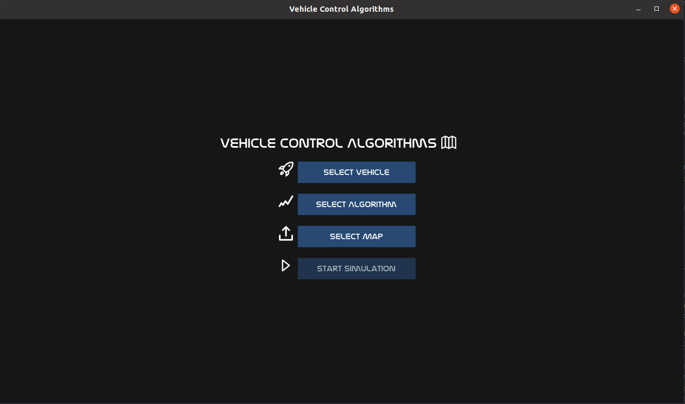
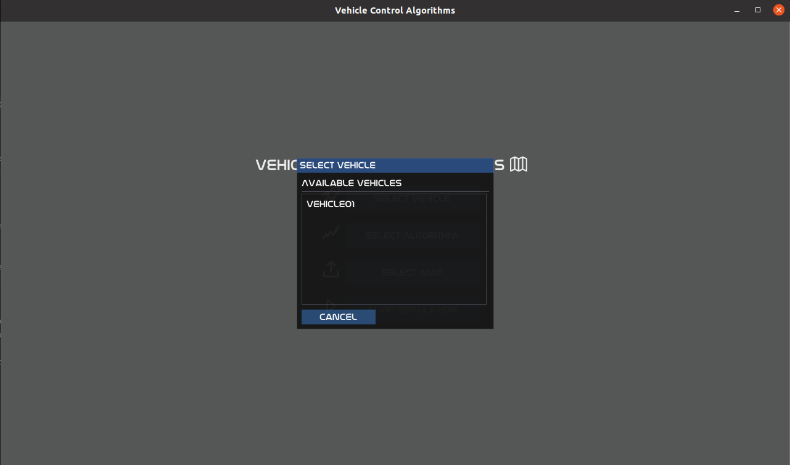
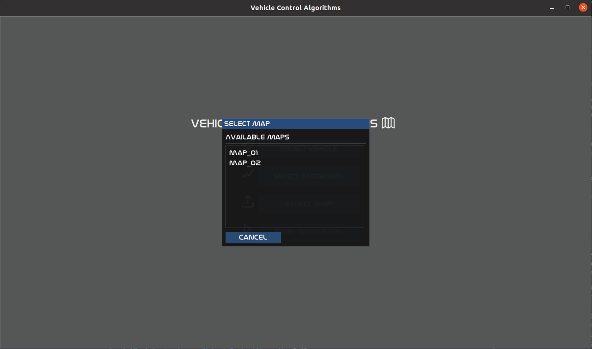
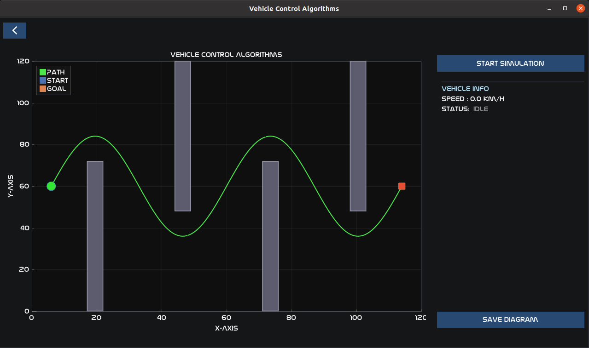
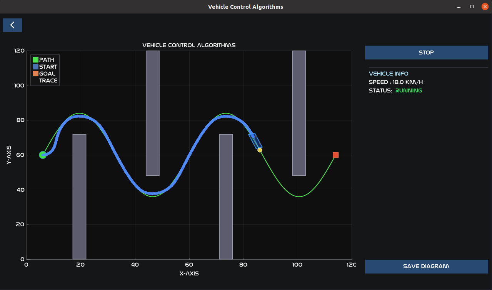
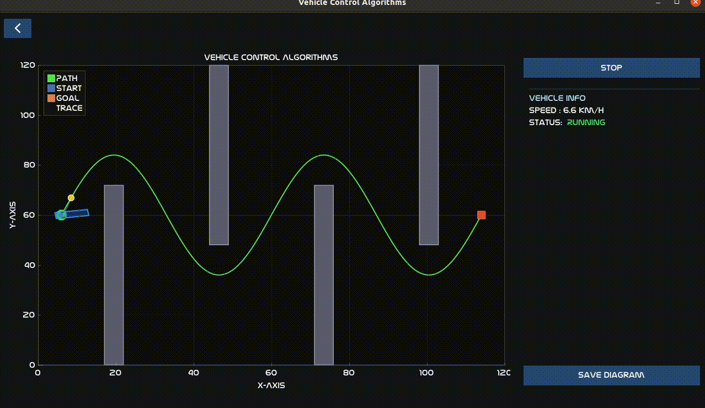

# Vehicle Control Algorithms

A desktop simulation environment for visualising and testing vehicle path-tracking algorithms.
Built with C++17, Dear ImGui, ImPlot, GLFW, and OpenGL 3.3.

---

## Features

- **Main screen** — select a vehicle model, a path-tracking algorithm, and a map before launching the simulation.
- **Simulation screen** — displays the loaded map (obstacles, start, goal) and the pre-computed reference path on an interactive Cartesian plot.
- **Live parameter tuning** — right panel contains per-algorithm sliders that can override the JSON defaults mid-simulation. Enable with the **Override Defaults** checkbox; each slider applies its new value the moment the mouse is released.
- **Hover tooltips** — hovering any parameter slider (while Override is active) shows a semi-transparent description of what the parameter controls. The tooltip fades out 0.25 s after the cursor moves away.
- **Bounded parameters** — every slider range comes from one table (`include/tuning_limits.hpp`). Steering-angle sliders stop at the vehicle's real maximum tire angle, and under the **Dynamic (Linear Tire)** model every Max Speed slider stops at the selected path's speed cap (computed from path curvature, tire friction and steering rate). Out-of-range values in a JSON file are clamped into the same ranges and listed in an on-screen notification.
- **Run outcome** — a run ends as **Done: goal reached** (within 1 m of the goal, or across the goal line near the path) or **Failed** on a collision, leaving the map, or a timeout. The vehicle body is checked against every obstacle each step.
- **Fixed-step simulation** — controller and vehicle model always advance in 1/60 s steps, independent of the display frame rate, so a run is reproducible on any machine.
- **Real-time telemetry** — speed (km/h), commanded steering and the wheel angle the actuator has actually reached (deg) are displayed live in the right info panel, plus a performance row (frame rate, controller + vehicle-model time per tick, resident memory).
- **JSON-driven configuration** — vehicles, maps, paths, and algorithm parameters are all defined in plain JSON files; no recompilation needed to add or tune scenarios.
- **Auto-discovery** — the UI automatically lists all vehicle files and map directories found under `data/`.
- **Application icon** — the window and dock entry display the project icon (`vca_application_icon.png`).

---

## Project Structure

```
VehicleControlAlgorithms/
├── CMakeLists.txt
├── config/
│   └── path_tracking/
│       ├── adaptive_pure_pursuit.json
│       ├── lqr.json
│       ├── mpc.json
│       ├── mppi.json
│       ├── pure_pursuit.json
│       └── stanley.json
├── data/
│   ├── maps/
│   │   ├── map_01/          # Corridor Map
│   │   │   ├── map.json
│   │   │   └── path.json
│   │   ├── map_02/          # Sine Wave Map
│   │   │   ├── map.json
│   │   │   └── path.json
│   │   └── map_03/          # Trapezoidal Course
│   │       ├── map.json
│   │       └── path.json
│   └── vehicle/
│       ├── vehicle01.json   # Bus 01 — city bus dynamics & geometry
│       └── vehicle02.json   # Car 01 — passenger car dynamics & geometry
├── docs/
│   ├── lqr.md
│   ├── pipeline.md
│   └── pure_pursuit.md
├── tools/
│   ├── generate_map02_path.py   # Regenerates and verifies map_02/path.json
│   ├── smooth_path.py           # Clothoid-smooths a map path (used for map_01, map_03)
│   └── path_tools.py            # Path checks: turning radius and body clearance per vehicle
├── tests/
│   ├── vehicle_model_tests.cpp  # Vehicle subsystem unit tests
│   ├── edge_tests.cpp           # Edge cases and regression checks (+ crash probes)
│   ├── sim_harness.cpp          # Headless closed-loop scenario runner
│   └── run_matrix.py            # Scenario matrix and sweeps
├── include/
│   ├── assets/
│   │   ├── fonts/           # Nasalization TrueType font
│   │   ├── icons/           # Dripicons v2 font + dripicon_v2_icons.hpp
│   │   └── images/          # Application icon (vca_application_icon.png)
│   ├── common/
│   │   └── json_value.hpp   # Shared JSON reader with syntax-error reporting
│   ├── map/
│   │   ├── map_data.hpp     # MapData, PathData, Point2D, Obstacle structs
│   │   └── map_loader.hpp   # MapLoader — loads and validates map.json + path.json, discovers maps
│   ├── path_tracking/
│   │   ├── adaptive_pure_pursuit/
│   │   ├── lqr/
│   │   ├── mpc/
│   │   ├── mppi/
│   │   ├── pure_pursuit/
│   │   ├── stanley/
│   │   ├── config_reader.hpp          # Config value reader with range clamping + warnings
│   │   ├── path_feasibility.hpp       # Path vs vehicle check: tightest bend, speed cap
│   │   └── path_tracking_algorithm.hpp # IPathTrackingAlgorithm interface
│   ├── sim/
│   │   └── sim_rules.hpp    # Speed command, body footprint, collision, termination (GUI + tests)
│   ├── tuning_limits.hpp    # Allowed range of every tunable parameter (sliders + JSON clamping)
│   ├── vehicle/
│   │   ├── aero/ drivetrain/ steering/ suspension/ tire/   # Vehicle subsystems
│   │   ├── composed_vehicle_model.hpp # Dynamic (Linear Tire) model
│   │   ├── vehicle_bicycle_model.hpp  # KinematicBicycleModel
│   │   ├── vehicle_model_factory.hpp  # MakeVehicleModel, TireAngleLimits
│   │   ├── vehicle_data.hpp           # VehicleData struct
│   │   ├── vehicle_loader.hpp         # VehicleLoader (range-checked)
│   │   └── vehicle_state.hpp          # VehicleState (rear-axle pose, applied wheel angle), VehicleControls
│   ├── third_parties/       # ImGui, ImPlot, stb_image (vendored)
│   └── vehicle_control_ui.hpp
└── src/
    ├── main.cpp
    ├── vehicle_control_ui.cpp
    ├── map/
    ├── path_tracking/
    ├── sim/
    └── vehicle/
```

---

## Dependencies

| Library | Version | Notes |
|---------|---------|-------|
| GLFW    | 3.x     | `sudo apt install libglfw3-dev` |
| OpenGL  | 3.3+    | Usually provided by GPU driver |
| Dear ImGui | 1.9x | Vendored under `include/third_parties/imgui/` |
| ImPlot  | 0.17+   | Vendored under `include/third_parties/implot/` |
| stb_image | —    | Vendored under `include/third_parties/stb/` |

---

## Build

```bash
mkdir build && cd build
cmake .. -DCMAKE_BUILD_TYPE=Release
make -j$(nproc)
./vehicle_control_algorithms
```

### Tests

```bash
ctest --output-on-failure        # unit tests, edge-case checks, crash probes, 6 closed-loop scenarios
python3 ../tests/run_matrix.py . results E1   # full scenario matrix (3 maps x 2 vehicles x 6 algorithms x 2 models)
```

All tests are headless. On a machine without GLFW/OpenGL, configure with `-DVCA_BUILD_GUI=OFF` to build only the core library and the tests (this is what CI does, see `.github/workflows/ci.yml`).

---

## Running with Docker

Docker lets you build and run the simulation on **Ubuntu 20, 22, 24, and Windows 11** without setting up a local build environment. The image is based on Ubuntu 22.04 and works on any of these hosts.

> **Why display forwarding?** Docker containers are headless by default. This application opens a real OpenGL window, so the container must forward its display output to the host's screen via X11.

### Prerequisites

- [Docker Engine](https://docs.docker.com/engine/install/) (Linux) **or** [Docker Desktop](https://www.docker.com/products/docker-desktop/) with WSL2 backend (Windows 11)
- Docker Compose plugin (`docker compose` — included with Docker Desktop and recent Docker Engine installs)

### Build the image

```bash
docker build -t vehicle-control-algorithms .
```

The multi-stage build compiles the project in a temporary builder stage and copies only the binary and runtime assets into the final image (about 280 MB); the builder stage also runs the test suite.

---

### Run on Linux (Ubuntu 20 / 22 / 24)

Allow Docker to connect to your local X server, then launch with Compose:

```bash
xhost +local:docker
docker compose up
```

Close the application window to stop the container. To revoke the X server permission afterwards:

```bash
xhost -local:docker
```

---

### Run on Windows 11

Windows 11 includes **WSLg** (WSL GUI support), which provides a built-in X/Wayland display server for WSL2 workloads. The easiest path is to run Docker from inside a WSL2 terminal, where the display is already set up automatically.

**Step 1 — Install WSL2 with Ubuntu** (skip if already done):
```powershell
# Run in PowerShell as Administrator
wsl --install -d Ubuntu-22.04
```

**Step 2 — Install Docker inside WSL2**:

Open the Ubuntu terminal and follow the [Docker Engine install guide for Ubuntu](https://docs.docker.com/engine/install/ubuntu/).

Alternatively, install [Docker Desktop](https://www.docker.com/products/docker-desktop/) on Windows and enable **WSL2 integration** for your Ubuntu distribution in *Settings → Resources → WSL Integration*.

**Step 3 — Run from the WSL2 Ubuntu terminal**:
```bash
# Clone or navigate to the project inside WSL2
xhost +local:docker
docker compose up
```

The OpenGL window will appear on your Windows desktop via WSLg, just like any other WSL GUI application.

---

### Customise configs without rebuilding

The `config/` and `data/` directories are baked into the image at build time. To edit algorithm parameters or add maps/vehicles without rebuilding, mount your local directories over the image copies:

```bash
xhost +local:docker
docker run --rm \
  -e DISPLAY=$DISPLAY \
  -v /tmp/.X11-unix:/tmp/.X11-unix:rw \
  -v "$(pwd)/config":/app/config \
  -v "$(pwd)/data":/app/data \
  --network host \
  vehicle-control-algorithms
```

---

### Troubleshooting

**`No protocol specified` / `GLFW Error 65544: X11: Failed to open display`**

The container couldn't authenticate with your host's X server. Run `xhost +local:docker` in a terminal on the host before starting the container (this is a per-login-session setting, so it's easy to forget after a reboot or after closing the terminal it was set in). Revoke access afterwards with `xhost -local:docker`.

---

## Example Usage

### 1. Launch and configure

On startup the main menu presents four steps. **Start Simulation** stays disabled until all three selections have been made.



---

### 2. Select a vehicle

Click **Select Vehicle** to open the picker. All JSON files found under `data/vehicle/` are listed automatically.

| File | Description |
|------|-------------|
| `vehicle01` | Bus 01 — 8 300 kg city bus, 4.335 m wheelbase |
| `vehicle02` | Car 01 — 1 500 kg passenger car, 2.6 m wheelbase |



---

### 3. Select an algorithm

Click **Select Algorithm** and choose the path-tracking controller to use.

| Algorithm | Description |
|-----------|-------------|
| Pure Pursuit | Geometric look-ahead controller |
| Adaptive Pure Pursuit | Look-ahead scales with speed and path curvature |
| LQR | Optimal state-feedback via discrete Riccati equation |
| Stanley | Front-axle geometry with cross-track + heading correction |
| MPC | Gradient-descent model predictive control |
| MPPI | Sampling-based model predictive path integral control |


---

### 4. Select a map

Click **Select Map** to see all map directories discovered under `data/maps/`.



---

### 5. Simulation screen

Once all three selections are confirmed, click **Start Simulation** from the main menu. The map is drawn with obstacles (grey), the reference path (green), the start marker (circle), and the goal marker (square). The right panel shows the Simulation Info and Parameter Tuning sections.

Click **Start Simulation** in the right panel to begin.



---

### 6. Live parameter tuning

The **Parameter Tuning** section in the right panel is available at all times on the simulation screen:

1. Check **Override Defaults** — the checkbox turns green and all sliders for the active algorithm become interactive.
2. Drag any slider to the desired value. The algorithm is rebuilt with the new value the moment you release the mouse button.
3. Hover a slider to see a description tooltip that fades out 0.25 s after the cursor moves away.
4. Uncheck **Override Defaults** to restore JSON defaults on the next simulation start.

Slider ranges are bounded so the simulation cannot be pushed past what the vehicle and path allow:

- **Max Delta** (Stanley, MPC, MPPI) stops at the vehicle's real maximum tire angle (0.456 rad / 26.1° for Car 01, 0.756 rad / 43.3° for Bus 01, from `minimum_turning_radius`).
- **Max Speed** is 0.5–15 m/s under the Kinematic model. Under **Dynamic (Linear Tire)** it stops at the path's speed cap, shown under the Override checkbox. The cap is `min(√(0.5·μ·g/κ_max), 0.65·δ̇_max / max|dδ/ds|)`: half the friction circle for cornering, and 65 % of the steering actuator rate for following the path's curvature changes. With the shipped data it is 4.5–5.6 m/s for Car 01 and 3.4–4.1 m/s for Bus 01.
- Switching to the Dynamic model mid-run lowers a Max Speed above the cap and shows which values changed.
- If a path is tighter than the vehicle can turn at full lock, a notification says so at Start.

When Override is not enabled, sliders are visible but greyed out, showing the currently loaded default values.

---

### 7. Pure Pursuit running

With the simulation running the vehicle (blue rectangle) follows the reference path. The yellow dot is the current lookahead target; the blue dot trail shows where the rear axle has been. Speed and steering angle update in real time in the right panel. Click **Stop** to pause (status **Paused**), **Resume** to continue, or **Restart** after the run has ended (**Done** or **Failed**) to run again from the start position.





---

## Adding a New Map

1. Create a directory under `data/maps/`, e.g. `data/maps/map_04/`.
2. Add `map.json` following the schema:

```json
{
  "name": "My Map",
  "world": { "width": 12.0, "height": 6.0 },
  "start": { "x": 0.5, "y": 3.0 },
  "goal":  { "x": 11.5, "y": 3.0 },
  "vehicle_radius": 0.2,
  "obstacles": [
    { "id": "wall_a", "shape": "rectangle", "x": 2.0, "y": 0.0, "width": 0.5, "height": 3.0 }
  ]
}
```

3. Add `path.json` in the same directory:

```json
{
  "map_name": "My Map",
  "algorithm": "A*",
  "waypoints": [
    { "x": 0.5, "y": 3.0 },
    { "x": 11.5, "y": 3.0 }
  ]
}
```

The map will appear automatically in the **Select Map** popup at next launch.

---

## Adding a New Vehicle

Create a JSON file under `data/vehicle/`, e.g. `data/vehicle/vehicle03.json`:

```json
{
  "name": "My Vehicle",
  "mass": 1500.0,
  "a": 1.2,
  "b": 1.3,
  "CA": 0.00045,
  "cog_height": 0.65,
  "yaw_inertia": 1960.0,
  "max_acceleration": 2.5,
  "max_deceleration": 4.0,
  "max_jerk": 2.5,
  "minimum_turning_radius": 5.5,
  "max_steering_wheel_angle": 720.0,
  "min_steering_wheel_angle": -720.0,
  "max_steering_wheel_rate": 400.0,
  "steering_wheel_to_tire_angle_ratio": 14.0,
  "wheelbase": 2.5,
  "wheel_radius": 0.32,
  "wheel_width": 0.20,
  "wheel_tread": 1.55,
  "front_overhang": 0.85,
  "rear_overhang": 0.75,
  "left_overhang":  0.10,
  "right_overhang": 0.10,
  "vehicle_height": 1.45,
  "tire": {
    "cornering_stiffness_coeff": 9.0,
    "friction_coefficient": 0.95
  },
  "suspension": {
    "enabled": true
  },
  "steering": {
    "use_rate_limit": true
  }
}
```

| Field | Description | Unit |
|-------|-------------|------|
| `mass` | Vehicle mass | kg |
| `a` | Distance from **front axle** to COG | m |
| `b` | Distance from **rear axle** to COG. Must satisfy `a + b = wheelbase` | m |
| `CA` | Mass-normalised aerodynamic drag coefficient: `(0.5 × ρ × Cd × Af) / mass` | 1/m |
| `cog_height` | *(optional)* Height of the COG above ground. Omit or leave `0` to disable load transfer — also requires `suspension.enabled: true` | m |
| `yaw_inertia` | *(optional)* Yaw (Z-axis) moment of inertia about the COG. Omit or leave `0` to fall back to the `mass·a·b` two-point-mass estimate — see [Estimating `cog_height` and `yaw_inertia`](#estimating-cog_height-and-yaw_inertia-when-oem-data-isnt-available) below | kg·m² |
| `minimum_turning_radius` | Minimum turning radius of the rear-axle centre at full lock. **Authoritative**: the tire angle is limited to `atan(wheelbase / minimum_turning_radius)` (and to the steering-wheel travel / ratio) | m |
| `min_steering_wheel_angle` | Right-hand steering-wheel travel (negative); the two directions may differ | deg |
| `max_acceleration` | *(optional)* Speed-controller acceleration limit. Default 2.0 | m/s² |
| `max_deceleration` | *(optional)* Speed-controller braking limit (positive). Default 4.0 | m/s² |
| `max_jerk` | *(optional)* Limit on the change of the acceleration command. Default 2.0 | m/s³ |
| `max/min_steering_wheel_angle` | Steering wheel travel limits | deg |
| `max_steering_wheel_rate` | Maximum steering rate | deg/s |
| `steering_wheel_to_tire_angle_ratio` | Steering ratio (steering wheel deg / tyre deg) | — |
| `wheelbase` | Front-to-rear axle distance | m |
| `wheel_radius` | Loaded tyre radius | m |
| `wheel_width` | Tyre section width | m |
| `wheel_tread` | Left-to-right wheel-centre distance | m |
| `front/rear_overhang` | Axle centre to vehicle body end | m |
| `left/right_overhang` | Wheel centre to vehicle body side | m |
| `vehicle_height` | Overall height | m |
| `tire.cornering_stiffness_coeff` | *(optional nested block)* Multiplier on each axle's static `Fz` used to derive linear cornering stiffness `Cf`/`Cr`. Omit for code default `6.0` | — |
| `tire.friction_coefficient` | *(optional)* Friction-circle limit μ used by the linear tire model. Omit for code default `1.0` | — |
| `suspension.enabled` | *(optional)* Opt in to load-transfer-aware axle loads. **Required for `cog_height` to have any effect** | bool |
| `steering.use_rate_limit` | *(optional)* Opt in to rate-limiting steering-angle change using `max_steering_wheel_rate`, instead of the default instantaneous-angle model | bool |

> `tire`, `suspension`, and `steering` are only consumed when the **"Dynamic (Linear Tire)"** vehicle-model fidelity is selected on the simulation screen — the default **"Kinematic"** fidelity ignores all of them.

Every numeric field is range-checked on load (for example `mass` 200–60 000 kg, `wheelbase` 1–12 m, `steering_wheel_to_tire_angle_ratio` 5–40, a derived maximum tire angle of 10–60°). A missing or out-of-range field is clamped to the nearest allowed value and listed in a "Vehicle file adjusted" notification when the vehicle is selected, so a typo can no longer produce an infinite steering lock or NaN states. A file that is not valid JSON (for example truncated) is rejected and the notification names the line of the syntax error.

The shipped vehicles use comfort limits: Car 01 2.5 m/s² acceleration, 4.0 m/s² braking, 2.5 m/s³ jerk; Bus 01 1.2 m/s², 2.5 m/s², 1.0 m/s³ (standing passengers).

### Estimating `cog_height` and `yaw_inertia` when OEM data isn't available

Neither field is measured/OEM data for the vehicles shipped in this repo — both are rough engineering estimates, documented here so they can be reproduced or refined for new vehicles:

- `cog_height ≈ k_h × vehicle_height`, with `k_h` around 0.4–0.55 depending on vehicle class — lower for buses/trucks (heavy chassis-mounted mass sits low, relatively more "dead" height above it), closer to (but still under) half for passenger cars/crossovers (engine + seated-occupant mass sits higher relative to the shorter body).
- `yaw_inertia = mass × k²`, where `k` (radius of gyration) is commonly approximated as a fraction of `wheelbase`: `k / wheelbase ≈ 0.4–0.5` for passenger cars, running somewhat higher for buses/trucks (elongated chassis, mass concentrated toward the ends rather than near the COG). If omitted, the code falls back to the cruder `mass·a·b` two-point-mass-at-the-axles estimate (see the comment in `ComposedVehicleModel`'s constructor).

---

## Adding a New Path-Tracking Algorithm

1. Create `include/path_tracking/<algo>/<algo>.hpp` and `src/path_tracking/<algo>/<algo>.cpp` implementing `IPathTrackingAlgorithm`.
2. Create `include/path_tracking/<algo>/<algo>_loader.hpp` and `src/path_tracking/<algo>/<algo>_loader.cpp`.
3. Add `config/path_tracking/<algo>.json` with the default parameters.
4. Add the source files to `CMakeLists.txt`.
5. Add the display name to `kAvailableAlgorithms` in `src/vehicle_control_ui.cpp`.
6. Add a JSON-loading block and a tuning struct to `InitSimulation()` / `RebuildAlgorithm()` in `vehicle_control_ui.cpp`, following the pattern of the existing algorithms.
7. Add a slider block for the new algorithm inside `RenderParamTuning()`.

---

## Included Maps

Maps are authored in metres and are the same physical course for every vehicle; the vehicle is drawn at its true size. `vehicle_radius` in `map.json` is only a clearance hint for path design, not a scale. Every reference path is checked with `tools/path_tools.py`: tightest bend ≥ 1.5 × each vehicle's turning radius and ≥ 0.8 m between the vehicle body and every obstacle. A `map.json`/`path.json` that is invalid (syntax error, fewer than two waypoints, start/goal outside the world) is rejected with a notification instead of being half-loaded.

| Map | Description |
|-----|-------------|
| **map_01** — Corridor Map | 120 m × 120 m. Three pairs of offset wall segments create a slalom. Corners are clothoid-smoothed (`tools/smooth_path.py map_01`), tightest bend 12.3 m. |
| **map_02** — Sine Wave Map | 120 m × 120 m. Two-period weave over and under four alternating baffles: 13 m arcs joined by straight flanks with clothoid (curvature-ramp) transitions, crests at y = 77 and valleys at y = 43. Generated by `tools/generate_map02_path.py`, which also checks the tightest bend against both vehicles and the body clearance to every baffle. |
| **map_03** — Trapezoidal Course | 120 m × 120 m. A large central block flanked by corner barriers forces the path around a trapezoidal circuit. Corners are clothoid-smoothed (`tools/smooth_path.py map_03`), tightest bend 11.9 m. |

---

## Included Algorithms

| Algorithm | Config file | Key parameters |
|-----------|-------------|----------------|
| **Pure Pursuit** | `pure_pursuit.json` | `lookahead_distance`, `lookahead_gain`, `max_speed`, `search_window` |
| **Adaptive Pure Pursuit** | `adaptive_pure_pursuit.json` | `min_lookahead`, `max_lookahead`, `speed_gain`, `curvature_gain`, `max_speed`, `search_window` |
| **LQR** | `lqr.json` | `q0`–`q5`, `r_steering`, `r_acceleration`, `r_scale`, `dare_iterations`, `dare_threshold`, `max_speed`, `search_window` (6-state, actuator-aware, see `docs/lqr.md`) |
| **Stanley** | `stanley.json` | `stanley_gain`, `min_speed`, `max_speed`, `max_delta`, `search_window` |
| **MPC** | `mpc.json` | `horizon_N`, `iterations` (QP solver), `rollout_dt`, `w_lat`, `w_heading`, `w_control`, `w_rate`, `max_delta`, `search_window` |
| **MPPI** | `mppi.json` | `horizon_T`, `num_samples_K`, `lambda`, `sigma_steer`, `rollout_dt`, cost weights, `max_delta`, `rng_seed`, `search_window` |

All parameters for all algorithms can be adjusted live at runtime via the **Parameter Tuning** panel in the simulation screen without recompiling or restarting. A live change keeps the vehicle's place on the path (the rebuilt algorithm searches the whole path once).

Every config value is clamped into the slider range when the file is loaded; a value that is out of range or not a number is listed in a "Config file adjusted" notification.

**MPC** linearises the error dynamics around the path's feed-forward steering angle and solves a small quadratic program over steering increments, with box limits on the steering angle and the actuator rate (FISTA, projected gradient). **MPPI** samples steering sequences and rolls them out with the real speed and the actuator's rate limit; at low speed its rollout step stretches so the horizon always previews at least 2.5 wheelbases. LQR, MPC and MPPI plan from the wheel angle the actuator has actually reached (`VehicleState::steering_angle`) and with the actuator of the selected model: the vehicle's steering rate under **Dynamic (Linear Tire)** (when its file enables rate limiting), instant steering under **Kinematic**. Switching the model mid-run updates the rate without resetting the controller.

---

## License

This project is licensed under the [Apache License 2.0](LICENSE).
